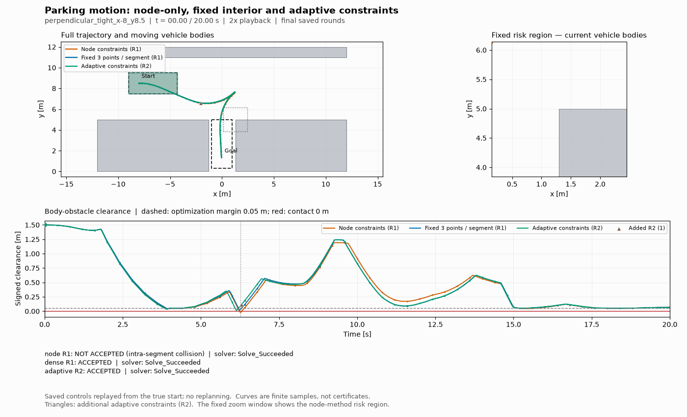
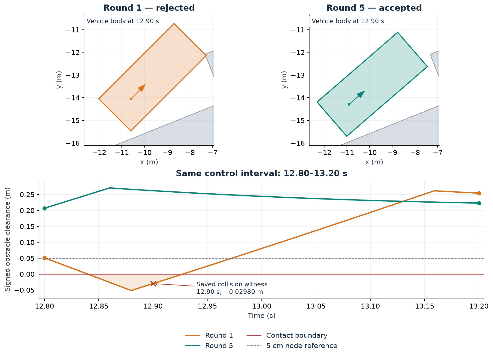
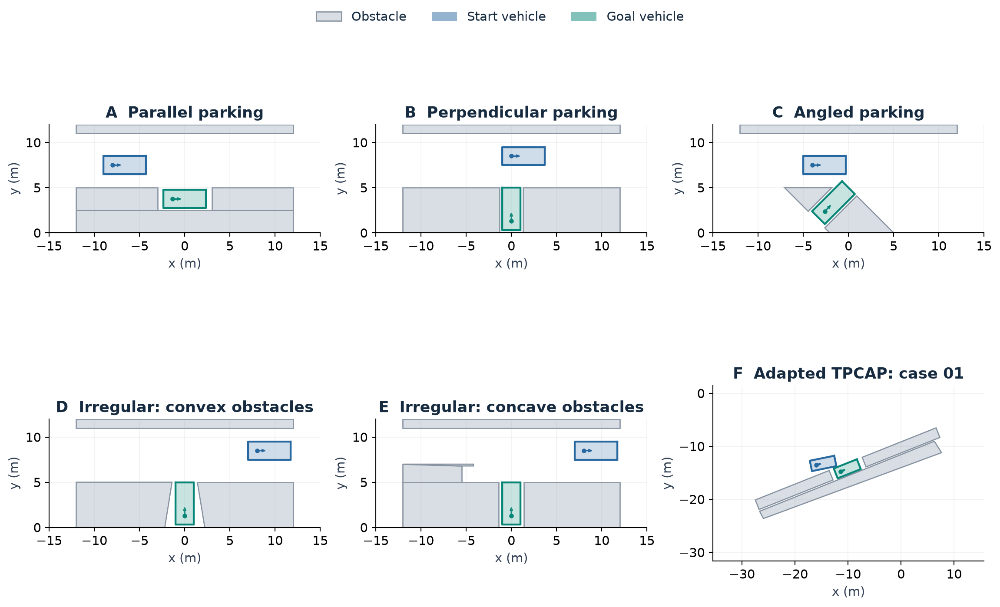
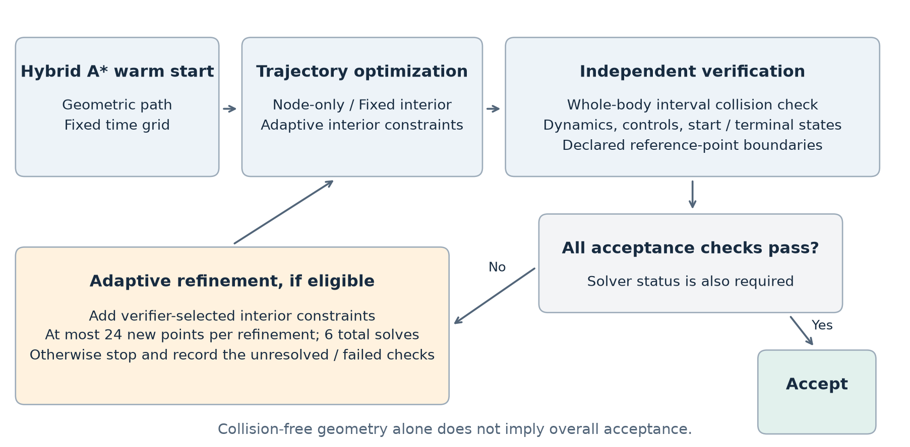

# Parking Trajectory Planning with H-OBCA and Adaptive Constraint Generation

**Yuwen Wang**  
MSc student in Mechanical Engineering, The University of Hong Kong

Collision constraints at discrete trajectory nodes can miss an overlap between the vehicle body and an obstacle during the intervening motion. This project combines a Hybrid A\* geometric warm start, H-OBCA-style trajectory optimization and an independent interval verifier. It compares node-only constraints, fixed interior constraints and adaptive constraint generation on a frozen 128-case parking benchmark.

The repository provides a consistent vehicle and motion model, recorded optimization rounds, independent trajectory checks, and an interactive viewer for inspecting successes and failures. Adaptive refinement adds collision constraints to the existing control intervals; it does not add state nodes or control degrees of freedom.

[Results](RESULTS.md) · [128-case atlas](docs/CASE_ATLAS_EN.html) · [HA failure study](docs/HA_FAILURE_REPORT_EN.html) · [Implementation notes](docs/IMPLEMENTATION_NOTES.md)

## Full parking motion



Case `perpendicular_tight_x-8_y8.5`, shown at **2× speed** using the saved final rounds: node-only R1, fixed-interior R1 and adaptive R2. The three panels follow the result viewer's layout. Vehicle bodies and the clearance cursor advance together from the true initial state to the end of the control sequence; the local zoom stays on the node-method risk region. The node-only trajectory is displayed for diagnosis and is **not accepted** because of an intra-segment collision. Fixed-interior and adaptive trajectories pass the recorded acceptance checks. The animation replays existing controls without replanning; the displayed clearance samples are not a replacement for interval verification.

## From a missed collision to an accepted trajectory

The example below compares adaptive rounds 1 and 5 for `tpcap_case01_project_4.7x2`. Both use the same control grid. Round 1 satisfies the node clearance diagnostic but overlaps an obstacle between nodes. Additional interior constraints change the optimized trajectory, and round 5 passes all acceptance checks.



The body snapshots use the same time, **12.90 s**, and the curves show the same interval, **12.80–13.20 s**. The round-1 collision witness has signed clearance **−0.029800 m**; it is a reported overlap, not necessarily the deepest overlap. The final trajectory has a recorded conservative whole-trajectory clearance lower bound of **0.002042 m**. The plotted curves are finite samples for illustration; acceptance comes from the saved interval verification and the other feasibility checks.

## Benchmark results

The three methods share the same HA seed, vehicle model, horizon policy and acceptance conditions for each case. The frozen backend experiment contains 112 cases with an HA seed and 16 without one. All 128 cases remain in the main denominator.

| Method | Collision constraints | Optimization rounds | Accepted / 128 | Accepted / 112 seeded cases |
|---|---|---:|---:|---:|
| Node-only (`node`) | Discrete nodes | 1 | 84 (65.63%) | 84 (75.00%) |
| Fixed interior (`dense`) | Nodes and 1/4, 1/2, 3/4 of each interval | 1 | 89 (69.53%) | 89 (79.46%) |
| Adaptive (`adaptive`) | Nodes and initial midpoints; further points selected by the verifier | Up to 6 | 98 (76.56%) | 98 (87.50%) |

Adaptive acceptance is **10.94 percentage points higher than node-only** and **7.03 points higher than fixed interior constraints**. These are comparisons of the complete workflows: the experiment does not isolate the effect of point selection from the additional solves and intermediate warm starts.

Of the 24 node-only trajectories with a passing node diagnostic but an intra-segment collision, 15 cases are accepted by the adaptive method; nine of those are also accepted by the fixed-interior method. Separately, 11 cases are accepted after the adaptive method's own first round exhibits this failure pattern. The two subsets have different definitions. Family counts, failure categories and per-case evidence are in [RESULTS.md](RESULTS.md).

## View the saved results

Open the repository root in VS Code and select a Python environment. The recorded environment is CPython 3.13.13 on Windows 11. The commands below use a local virtual environment without requiring shell activation.

**Windows PowerShell — from the repository root:**

```powershell
py -3.13 -m venv .venv
.\.venv\Scripts\python.exe -m pip install -r requirements-viewer.txt
.\.venv\Scripts\python.exe view_results.py
```

**Linux or macOS — with Python 3.13 installed:**

```bash
python3.13 -m venv .venv
.venv/bin/python -m pip install -r requirements-viewer.txt
.venv/bin/python view_results.py
```

The viewer requires NumPy, Matplotlib and Tkinter. In VS Code, select the newly created environment and run `view_results.py`. It opens existing results, lets you choose a case and adaptive round, compares the three methods, and supports motion playback and figure export. Opening the viewer never starts planning. Cross-platform installation has not been independently validated.

After selecting or activating the intended environment, these commands list cases or export a figure without opening a window:

```bash
python view_results.py --list
python view_results.py --case tpcap_case01_project_4.7x2 --round 1 --export exports/round1.png
```

The default display replays the complete control sequence from the true initial state. The optional `saved` mode resets each local arc at its saved node and is intended for diagnosing propagation differences.

## Scenes

The benchmark has **128 cases across 39 distinct obstacle layouts**. Several cases share a layout and vary the initial pose. The six panels below show representative inputs, with obstacles and the vehicle bodies at the start and goal; they do not show planned trajectories.



Panels use the configured map bounds and individual axis scales. Vehicle geometry and obstacle coordinates come directly from the saved scenes.

| Scene family | Cases | Variations represented |
|---|---:|---|
| Standard parallel and perpendicular parking | 60 | Slot dimensions and initial poses; 30 cases of each parking type |
| Angled parking | 36 | Slot angle, width and initial pose |
| Irregular obstacles | 12 | Convex and concave polygon arrangements |
| Adapted TPCAP | 20 | Benchmark layouts with the project's vehicle model |
| Total | 128 | 39 layouts after obstacle-coordinate deduplication |

This is a development and regression suite, with no independent held-out layout set. TPCAP cases use the project's vehicle parameters and are not directly comparable with the competition's scores. The [case atlas](docs/CASE_ATLAS_EN.html) preserves the complete three-method result snapshot and its filters.

## Method and acceptance



Hybrid A\* supplies a geometric path. The warm-start stage maps it onto a fixed control grid, and the optimizer solves one of the three constraint policies. The independent verifier checks the vehicle body's motion between nodes using distance and motion bounds. For the adaptive method, eligible interior locations flagged by collision or unresolved checks are added as constraints before the next solve, subject to the round and point limits.

**A result is accepted only when all checks pass:** an allowed solver-success status; initial-state and dynamics consistency; control limits; terminal pose and speed; the existing reference-point boundary check; and a strictly positive whole-trajectory obstacle-clearance result. Geometric `PASS` alone is insufficient. The boundary check applies to the reference point and is not a full-body region-containment guarantee.

## Parameters

The authoritative configuration is `contract.json`. The model is a low-speed kinematic bicycle with constant steering and acceleration on each interval. Speed may cross zero.

| Vehicle and motion parameter | Value |
|---|---|
| Vehicle body | 4.7 m × 2.0 m |
| Wheelbase | 2.7 m |
| Rear-axle reference to body edges | 3.7 m forward; 1.0 m rearward; 1.0 m to either side |
| Minimum turning radius | 3.95 m |
| Maximum steering angle | `atan(2.7 / 3.95)` ≈ 0.5996 rad (34.35°) |
| Speed and acceleration bounds | ±3.0 m/s; ±1.0 m/s² |
| Steering change between controls | At most `0.6 × Ts` rad = 0.24 rad per step |
| Physical time step `Ts` | 0.4 s |
| Horizon policy | Seed-length based; configured interval count 40–160; observed 40–105 in the frozen run |
| Observed physical horizon | 16–42 s |

| Constraints and acceptance parameter | Value / role |
|---|---|
| Clearance at constrained optimization poses | 0.05 m hard margin + 0.001 m solver buffer |
| HA obstacle-clearance policy | 0.05 m |
| Whole-trajectory obstacle acceptance | Strictly positive clearance; contact is not accepted |
| Node 0.05 m check | Recorded diagnostic; not a separate final acceptance gate |
| Terminal speed | Optimizer target `v_N = 0`; replay tolerance 10⁻⁶ m/s |
| Terminal pose tolerances | 0.05 m per position component; 0.05 rad heading |
| Terminal constraint inset | 0.0002 m in position; 0.00002 rad in heading |
| Interval-verifier limits | Depth 12; 16,000 distance queries |
| Geometry numerical allowance | `max(10⁻⁷ m, 64 × machine epsilon × coordinate scale)` |
| Dynamics residual / initial-state tolerance | 2 × 10⁻⁶ / 10⁻⁶, applied to the state components |
| Global replay drift limits | 10⁻⁴ m position; 10⁻⁵ rad heading |
| Control-limit numerical tolerance | 10⁻⁶ in the corresponding control units |

| Search and optimization parameter | Value |
|---|---|
| HA position / heading bins | 0.2 m / 5° in the backend benchmark's source search |
| HA motion primitives | 0.3 m; 11 curvature choices |
| Heuristic inflation | 1.0 m = 5 grid cells |
| HA expansion cap | 200,000 per search |
| IPOPT iteration cap | 1,500 per solve |
| IPOPT convergence / constraint tolerances | `tol = 10⁻⁸`; `constr_viol_tol = 10⁻⁸`; `acceptable_tol = 10⁻⁶`; bound relaxation disabled |
| Adaptive limits | 6 total solves; at most 24 new interior points per refinement |
| Current project time caps | None; IPOPT time options omitted, library defaults retained |
| Historical HA seed time limit | 90 s per case |

## Reproduce the experiments

Install the full dependencies in the selected environment to run planning or tests:

```bash
python -m pip install -r requirements.txt
python -m pytest -q -s
```

On Windows, `-s` disables pytest output capture, which can interfere with CasADi/IPOPT initialization.

Pinned package versions are recorded in `requirements.lock.txt`. Tests cover analytic propagation, independent ODE comparisons, geometric bounds, terminal conditions, failure classification and viewer isolation; they do not rerun the entire benchmark.

```bash
# Repeat the backend comparison using the bundled HA paths.
python run_planning.py --all --source seeded --workers 6 --output results_other

# Run one case with a new HA search.
python run_planning.py --case perpendicular_wide_x0_y8.5 --source fresh --output results_single

# Rerun both the front end and all three backends on all 128 cases.
python run_planning.py --all --source fresh --workers 3 --output results_fresh
```

Use a new output directory when code or configuration changes. Existing results are skipped. Default data paths are relative to the entry script; user-supplied relative paths are resolved from the terminal's current directory.

The frozen backend results use `inputs/ha_r395`: 112 paths returned by a historical 90 s search, including eight that failed its sampled 5 cm check. The optimizer can receive such geometrically imperfect seeds. The 16 missing paths remain failures in the overall denominator. A `fresh` run is a separate experiment under the current configuration.

## Related work and research scope

The planning structure follows Hybrid A\* and H-OBCA, while obstacle separation uses OBCA's dual formulation [1–3]. Adaptive constraint generation is related to semi-infinite trajectory optimization [4]. Continuous collision formulations and conservative subdivision provide other ways to address motion between nodes [5–6]. This repository's contribution is the implementation, independent verification and reproducible comparison of the three constraint workflows under a shared model.

The interval result is a conditional numerical check under that model. A certified lower bound is conservative and differs from a sampled minimum or a physical measurement. The model excludes perception and localization error, steering-actuator dynamics, gear-shift delay and tracking error. The fixed grid and lack of an independent test set limit conclusions about harder or unseen layouts.

The separate [HA failure study](docs/HA_FAILURE_REPORT_EN.html) examines 24 front-end failures and reports 22 recoveries after an export correction. Its combined historical ledger of 126/128 is neither a full-corpus interval certificate nor a backend success rate. The node, fixed and adaptive backend scores remain 84, 89 and 98. Known solver/process issues and historical fingerprint details are documented in [Implementation notes](docs/IMPLEMENTATION_NOTES.md).

## Repository map

| Path | Purpose |
|---|---|
| `view_results.py` | Read-only viewer and figure export |
| `run_planning.py` | Explicit planning entry |
| `python_scripts/safe_parking/` | Optimization, validation, refinement and viewing |
| `python_scripts/traj_py/` | HA search, Reeds–Shepp geometry and warm-start construction |
| `inputs/` | Frozen scenes and HA seeds |
| `results/seeded/` | Three-method results and individual adaptive rounds |
| `docs/` | Case atlas, HA failure study, figures and implementation notes |
| `tests/` | Unit and contract tests |

## Attribution and references

Author: **Yuwen Wang**, MSc student in Mechanical Engineering, The University of Hong Kong. Citation metadata are provided in [CITATION.cff](CITATION.cff). English documentation and packaging were prepared with AI assistance; the reported results come from the saved experimental records.

The project-code license status is recorded in [LICENSE](LICENSE). Third-party code and benchmark materials retain their own terms; see [THIRD_PARTY_NOTICES.md](THIRD_PARTY_NOTICES.md).

1. Dolgov et al. *Path planning for autonomous vehicles in unknown semi-structured environments*. IJRR, 2010. [DOI](https://doi.org/10.1177/0278364909359210)
2. Zhang, Liniger and Borrelli. *Optimization-based collision avoidance*. TCST, 2021. [DOI](https://doi.org/10.1109/TCST.2019.2949540)
3. Zhang, Liniger, Sakai and Borrelli. *Autonomous parking using optimization-based collision avoidance*. CDC, 2018. [DOI](https://doi.org/10.1109/CDC.2018.8619433)
4. Hauser. *Semi-infinite programming for trajectory optimization with non-convex obstacles*. IJRR, 2021. [DOI](https://doi.org/10.1177/0278364920983353)
5. Guthrie. *A differentiable signed distance representation for continuous collision avoidance in optimization-based motion planning*. CDC, 2022. [DOI](https://doi.org/10.1109/CDC51059.2022.9992439)
6. Zhang et al. *Provably feasible semi-infinite program under collision constraints via subdivision*. T-RO, 2024. [DOI](https://doi.org/10.1109/TRO.2024.3391649)
7. Li et al. *Online competition of trajectory planning for automated parking: Benchmarks, achievements, learned lessons, and future perspectives*. T-IV, 2023. [DOI](https://doi.org/10.1109/TIV.2022.3228963)
